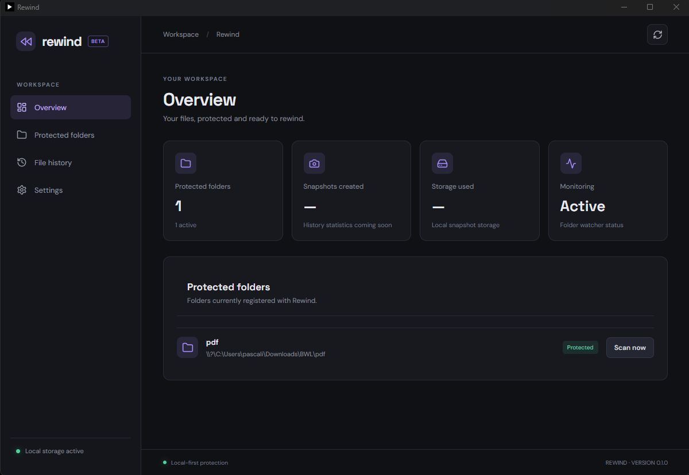
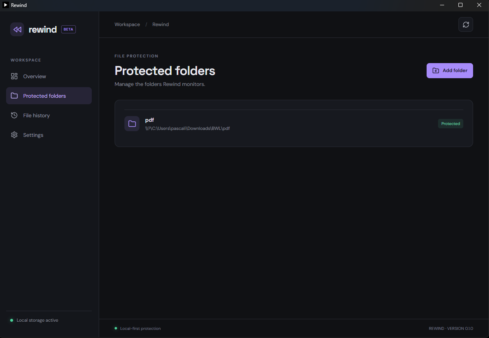
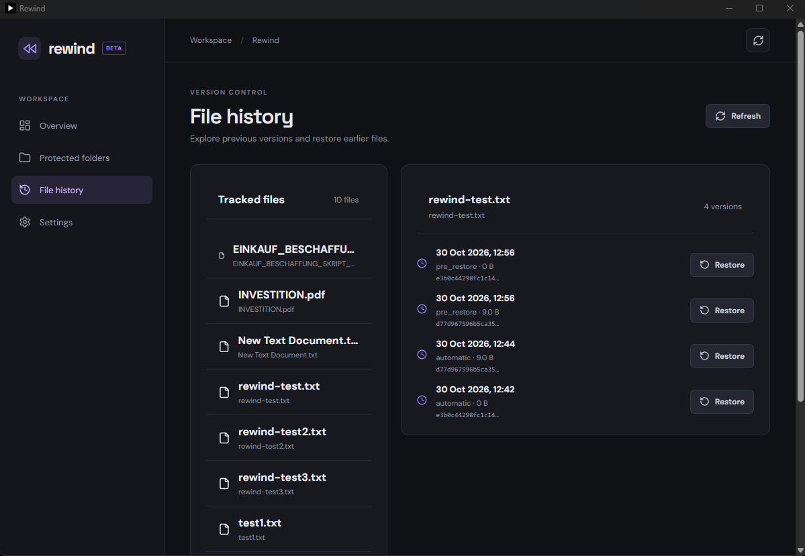
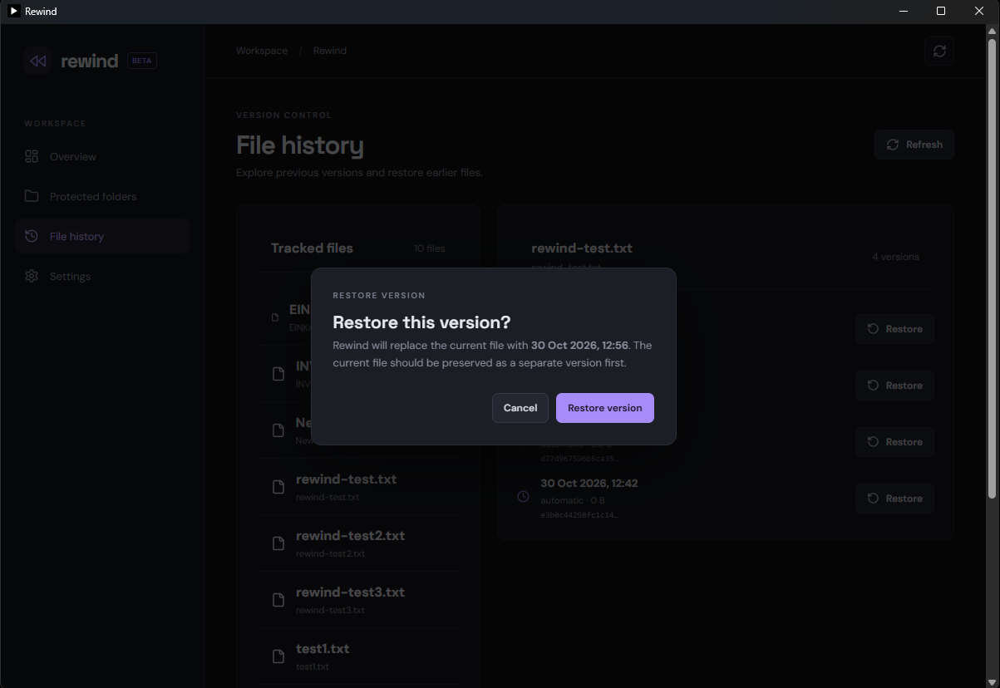

# Rewind

A local-first Windows desktop application that automatically tracks file changes, saves previous versions, and lets you restore files whenever you need them.

Rewind helps protect your work by keeping a history of your files without relying on cloud storage.

## Features

- **Automatic snapshots** – Detects file changes and saves new versions automatically.
- **Protected folders** – Choose which folders Rewind monitors.
- **Version history** – Browse previous versions of your files.
- **Restore files** – Restore an earlier version with a simple confirmation.
- **Local storage** – Your snapshots stay on your computer.

## Screenshots

### Dashboard


### Protected Folders


### File History


### Restore Version


## Tech Stack

- React
- TypeScript
- Tauri 2
- Rust
- SQLite

## Getting Started

### Prerequisites

Make sure you have installed:

- [Node.js](https://nodejs.org/)
- [Rust](https://www.rust-lang.org/tools/install)
- [Microsoft C++ Build Tools](https://visualstudio.microsoft.com/visual-cpp-build-tools/)
- [WebView2 Runtime](https://developer.microsoft.com/en-us/microsoft-edge/webview2/)

### Installation

Clone the repository:

```bash
git clone https://github.com/YOUR-USERNAME/rewind.git
cd rewind
```

Install dependencies:

```bash
npm install
```

Run the application in development mode:

```bash
npm run tauri dev
```

## Building

To create a Windows desktop build:

```bash
npm run tauri build
```

The generated application bundles can be found in:

```text
src-tauri/target/release/bundle/
```

## License

No license has been specified yet.